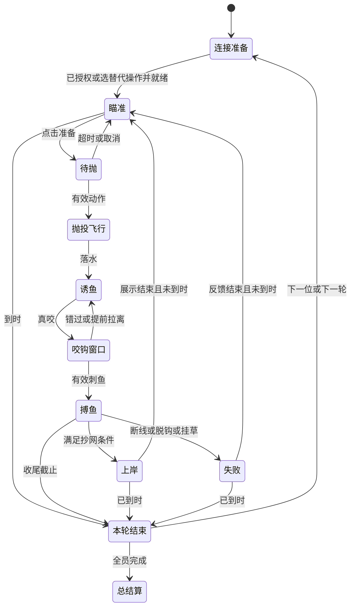

# 挥竿！湖畔对决 · 手机体感钓鱼 PRD

- 版本：v1.0 产品设计稿
- 日期：2026-10-31
- 补充：2026-11-01，明确触觉反馈与手机浏览器支持边界，并核对 v0.24.0 平台变化。
- 适用仓库：Frank-LSY/virtual-golf（SwingLink），当前核对基线 `c6a7583`。
- 产品形态：电脑浏览器呈现 3D 湖面，手机作为鱼竿控制器。
- 交付状态：需求与研究文档；尚未开发钓鱼功能、未完成真机手感验证。

## 1. 产品定义与核心决策

让玩家把手机当鱼竿：观察水面，挥动手机把饵抛进目标水域，抓住咬钩时机抬竿，再通过左右控竿、抬竿拉鱼和放竿收线，把鱼带回岸边。与朋友比赛时，比选点、精度、节奏和风险判断。

核心体验句：**“这条大鱼是我看准位置抛过去，再一松一拉遛上来的；下一局我能赢回来。”**

本稿作出以下默认决策，可据原型测试修订：

| 项目 | 首版决策 | 原因 |
| --- | --- | --- |
| 定位 | 轻竞技、可聚会的体感钓鱼 | 保留钓鱼动作与策略，把等待和知识门槛压到朋友愿意轮流玩的程度 |
| 主设备 | 电脑大屏 + 一台或多台手机 | 沿用当前平台，手机承担动作，大屏承担观察 |
| 握持 | 默认竖握，手机顶部相当于竿尖；左右手均可 | 比照搬滚球的横握，更容易理解抬竿、放竿和侧拉 |
| 操作 | 局内以体感为主；准备、暂停等用大按钮 | 避免拿手机菜单时误甩；不要求另一只手持续点屏幕 |
| 核心收线 | 抬竿拉鱼，放低竿时自动回收可用松线 | 用一台手机形成完整动作循环，不要求模拟不存在的第二个摇轮 |
| 内容 | 一个湖面、三个钓区、三类鱼、两个诱鱼节奏 | 优先证明动作和比赛成立 |
| 比赛 | 同一大屏、2–4 人轮流挑战、两轮积分赛 | 控制制作范围，也让旁观者看得清鱼与玩家动作 |
| 随机性 | 练习可变化；标准赛用固定赛题和确定性机会表 | 成绩主要来自操作和决策，不由抽到巨鱼决定 |
| 能力标尺 | 标准模式统一映射；舒适模式允许辅助，成绩分开 | 归零识别握姿，不能用个人最大甩速定义满力 |

## 2. 用户、场景与需求

主要用户是已经愿意拿手机当体感控制器的休闲玩家，不要求懂真实钓鱼术语。

场景 A：一个人用五分钟练抛投和搏鱼，想明显感到“刚才冲太猛，这次会让线了”。

场景 B：2–4 个朋友看同一个电脑屏幕，扫码后轮流比赛；没轮到的人也能看懂谁领先、谁正在冒险。

场景 C：熟悉玩法后，选择同一赛题重赛，通过更准的抛投或更大胆的路线追回比分。

| 用户任务 | 应获得的体验 |
| --- | --- |
| 第一次拿起手机 | 一分钟内知道怎样抛出去，不需要做轻挥、重挥等能力校准 |
| 把饵抛进芦苇边 | 能预测大致落点，偏差可以归因到自己的方向或速度 |
| 鱼突然挣扎 | 看懂预兆，及时让线，成功化解一次危机 |
| 比赛落后 | 能选择更高收益钓点追分；冒险有清晰代价 |
| 输掉一条鱼 | 知道是持续硬拉、松线过久，还是进了水草，愿意马上再来 |
| 临时被打断 | 暂停后不会回来发现鱼已经逃掉 |

## 3. 业界调研与取舍

### 3.1 调研方法及证据边界

于 2026-10-31 检索并阅读官方产品页、发行商介绍与浏览器官方技术文档。以下是案头研究，**没有试玩这些商业游戏，也没有测量其输入算法、延迟或平衡性**。官方列出的功能作为事实；“值得借鉴”和本稿参数属于设计判断。旧产品页面只用于研究玩法，不据此推断当前在线服务可用性。未以销量、商店评分或宣传语证明本项目一定好玩。

### 3.2 竞品对照

| 参考 | 官方可核实事实 | 对本产品的启发（判断） | 本期取舍 |
| --- | --- | --- | --- |
| Legendary Fishing | 官方商店说明支持 Joy-Con 体感抛投、传统控制及单机 1–4 人。[S1](https://www.nintendo.com/US/store/products/legendary-fishing-switch/) | 动作操作与替代操作可以共同服务家庭聚会 | 借鉴易懂的抛竿动作；手机输入另行验证，不能假定等同 Joy-Con |
| Ace Angler: Fishing Spirits | 官方介绍包含街机、派对玩法，以及比最重或最贵鱼的竞赛；在线对战最多四人。[S2](https://www.bandainamcoent.com/games/ace-angler-fishing-spirits) | 钓鱼可以拥有观众看得懂的胜负目标 | 借鉴短局、明确分数；不做币制、抽奖和大量派对小游戏 |
| Bait! | 官方说明四人可一起钓鱼，也可进行友好钓鱼比赛。[S3](https://www.resolutiongames.com/bait/) | 放松和竞争不必互相排斥 | 保留练习与朋友赛，不在首版做大型社交空间 |
| Fishing Sim World: Pro Tour | 官方介绍自定义多人比赛可设计分、鱼种、时间和天气。[S4](https://live.dtgfishing.com/news/what-is-pro-tour) | 赛制本身能制造不同决策，不必全靠增加鱼种 | 首版固定清楚的积分规则，后续再开放自定义赛制 |
| SEGA Bass Fishing | 发行商页面列出不同钓点、鱼饵和锦标赛，并描述环境影响鱼的行为。[S5](https://store.steampowered.com/app/71240/SEGA_Bass_Fishing/) | 选择在哪里钓、怎么诱鱼，是动作之外的策略来源 | 三个读得懂的水域、两个节奏即可；不复制复杂装备知识 |
| WEBFISHING | 开发者商店介绍强调和朋友一起休闲钓鱼、收集与展示。[S6](https://store.steampowered.com/app/3146520/WEBFISHING/) | 鱼获也能成为朋友间的谈资 | 做鱼获卡和赛后对比；暂不做聊天世界或数值养成 |

### 3.3 研究结论转成产品要求

1. 动作要有语义：抛、抬、让、侧拉四个动词，比“摇一摇加力量”更接近鱼竿体验。
2. 技巧要分层：新手能钓近岸小鱼，熟手靠精准落点和搏鱼节奏取得更高收益。
3. 比赛要先让人看懂：统一鱼获分值、可见剩余时间、明确追分风险。
4. 等待要服务悬念：看得到鱼接近和试探，不用随机长等待填时长。
5. 手机没有实体鱼竿的阻力反馈，必须用竿弯、水花、线声和明确状态弥补；这是本产品的设计要求，不是竞品实测结论。

### 3.4 尚待验证的问题

动作直觉能否迁移到单手机？放竿自动收线是否容易理解？旁观者是否愿意看完一轮？固定鱼获是否仍有“中大鱼”的惊喜？这些问题由第 16 节的原型与试玩验证回答，案头调研不能代替验证。

## 4. 范围、优先级与成功定义

### 4.1 P0：首版完整可玩范围

- 独立「体感钓鱼」Tab，切回高尔夫或滚球能恢复原有游戏状态。
- 单人引导、自由练习、单人标准计分、2–4 人本地轮流积分赛。
- 一个统一 3D 湖面，浅湾、芦苇口、深水三个钓区，三类鱼。
- 瞄准、挥动抛投、诱鱼、刺鱼、搏鱼、收线、上岸、失败与重抛完整闭环。
- 同赛题、同装备、同计分；暂停、断线、重连和异常成绩处理。
- 手机体感、手机触控、电脑键鼠三种可通关输入；成绩明确标注输入类别。
- 原始动作回放、识别结果和比赛事件日志；可检验的自动测试与独立真机验收。

### 4.2 P1：首版验证通过后

- 2–4 人同时钓鱼，分屏或聚焦镜头，单独解决信息拥挤和权威同步。
- 每日赛题、幽灵成绩、挑战分享；发布前补持久化和成绩校验。
- 合作钓大鱼、指定鱼种赛、最佳两条计分赛。
- 更多动作风格、鱼种和天气，但不通过装备等级破坏标准赛公平。

### 4.3 不在首版

公网匹配、跨洋实时比赛、全球权威排行榜、语音聊天、开放世界行走、船只驾驶、商城、付费数值装备、复杂鱼饵配方、鱼类生态模拟、实体阻力硬件。不为钓鱼重构现有所有游戏或训练一个大而全的动作模型。

### 4.4 目标（均为待测验收门槛）

| 维度 | 原型/首版目标 |
| --- | --- |
| 理解成本 | 至少 5/6 名首次玩家在讲解后 60 秒内独立完成有效抛投 |
| 初次成功 | 至少 5/6 名首次玩家在辅助教学中 3 分钟内钓起首鱼 |
| 控制可学 | 至少 4/6 名玩家第二组 5 次定点抛投的中位误差小于第一组 |
| 失败可解释 | 至少 5/6 名玩家能正确说出最近一次逃鱼的直接原因 |
| 趣味 | 至少 4/6 名玩家在可自由结束时愿意主动再玩一局；记录原因 |
| 动作负担 | 连玩 10 分钟，无需靠极限甩动达标；若至少 2 人明显腕部疲劳则调整 |
| 聚会 | 两人标准赛约 4–6 分钟，四人约 8–11 分钟；旁观者能说出领先者和追分办法 |

小样本仅用于迭代方向，不能当作市场留存结论。

## 5. 游戏循环与节奏

观察钓点 → 准备抛竿 → 定向挥动 → 落饵 → 用节奏诱鱼 → 判断真咬钩 → 抬竿刺鱼 → 侧拉、收放线 → 上岸计分或解释失败 → 选择下一竿。

一条普通鱼目标为 15–30 秒；大鱼 30–50 秒，均包含抛投和诱鱼。准确落在有鱼水域且节奏正确后，目标 3–7 秒进入可刺鱼机会。无效钓点在 5 秒内给出“附近没有鱼影，换个位置试试”，不让玩家无限空等。这些时长是初始设计值，不保证每条鱼固定耗时。

节奏呈现“短观察—轻动作—突然中鱼—一段拉扯—明确结果”。鱼获动画不超过 2 秒，可跳过；标准赛动画期间比赛时间继续走，但奖励在上岸判定时已锁定，不受跳过速度影响。

## 6. 手机就是鱼竿：输入规则

### 6.1 启用、握姿与归零

1. 电脑选择游戏，手机扫码进入已有配对链路；明确指定当前控制手机。
2. 手机点击「启用鱼竿」，在用户点击中申请传感器权限。浏览器要求安全上下文及用户触发；兼容性需运行时检测。[S7](https://developer.mozilla.org/en-US/docs/Web/API/DeviceOrientationEvent/requestPermission_static)
3. 自然竖握，顶部朝前、手腕放松，稳定约 0.6 秒完成基准。只处理握姿与零偏，不采集个人最大挥速。
4. 大屏展示同步鱼竿，左右轻倾和小幅抬放即可看见对应关系；可直接进入教学水域。
5. 左右手配置只调整坐标和界面位置，不改变鱼的强度或得分。

竖握为首版验收主路径。横握如开放，必须有独立轴向配置和实测；不能把滚球横屏倾斜映射直接当作钓鱼完成。旋转屏幕、重新归零或切换手机均进入暂停，明确继续后恢复。

### 6.2 瞄准与抛投

- 准备状态轻微左右倾斜，调整相对岸线的抛投扇区；示意落点跟随，方向有死区与限幅。
- 方位以游戏镜头和本次握姿为参考，不要求手机指向真实世界的北方。避免长期依赖绝对航向。
- 点击一次大按钮「准备抛竿」，开放 5 秒动作窗口；超时自动解除，无惩罚。开始比赛的首个窗口前有统一倒计时。
- 后引再前挥，完成一次有效动作即抛出；窗口内不能重复触发。向后回手、放下手机和其他游戏的挥杆事件不能触发。
- 后引幅度与前挥平均角速度共同决定距离；峰值只用于异常检测和有限修正，不能靠一个采样尖峰获得满力。
- 方向以准备末段的稳定瞄准为主，加一个有界的挥动方向修正（初始最多 ±8°）；不要求精确复原手部三维轨迹。
- 没有有效后引、动作过短、采样断流等判为无效动作，保留饵并解释；比赛时钟继续，玩家可重新准备。

标准映射的目标：相同设备上轻、中、重动作形成可重复的近、中、远落点；超过舒适速度上限也不继续加距离。最远点必须能由正常小臂动作到达，不要求举过头或甩到身后。

### 6.3 诱鱼与刺鱼

落饵后进入诱鱼阶段，小幅动作不再触发抛投。缓慢抬放产生缓拖，短促小抬产生轻抽。鱼影靠近、浮漂轻点为试探；浮漂明显下沉并配清晰声音才进入刺鱼窗口。

初始窗口：教学 1.2 秒，标准 0.9 秒。窗口起点以大屏可见咬钩事件为准，不先在后台倒计时。玩家及时抬竿约 12°–25°并达到最小动作速度即可刺鱼，超过阈值不增加挂钩收益。

提前抬竿会拉离鱼饵，鱼暂退，延迟约 2 秒再试；错过窗口则鱼离开，留在本钓点可重新诱鱼。标准赛同一鱼的再次试探需要冷却，不能高频抽动刷窗口。

### 6.4 搏鱼与收放线

| 动作 | 游戏效果 | 画面解释 |
| --- | --- | --- |
| 适度抬高竿尖 | 有效张力下把鱼拉近、消耗鱼体力 | 竿身变弯、距离下降 |
| 缓缓放低竿尖 | 自动收回这次拉鱼产生的可用松线 | 卷线器转动、线长缩短 |
| 鱼冲刺时放低一点 | 降低拉力，必要时放出鱼线 | 距离可能回升、张力回落 |
| 左右侧控竿 | 调整鱼的移动趋势，把鱼带离障碍 | 鱼的速度逐渐改变，不会瞬移 |
| 长时间竿尖过低 | 张力不足，增加脱钩风险 | 鱼线变松、明确警告 |
| 持续高抬硬拉 | 张力积累，最终可能断线 | 竿身剧弯、紧线声持续 |

放竿的处理优先级：先缓解高张力；只有线不绷紧、且存在上次有效拉鱼留下的松线时才自动收回。收回量受可用松线与最大回收速度限制。单独反复放竿、快速抖腕或静止不动都不能凭空收短鱼线。

一轮抬放有效周期初始约 0.6–2 秒；更快不会提高单位时间收益。没有“抬一下自动减固定距离”的跳步规则，所有变化必须经过持续的鱼、线和竿状态模拟。放竿自动收线是游戏辅助，不宣称真实还原卷线器。

### 6.5 替代操作与辅助

手机触控：拖动二维竿姿区控制左右及抬放；准备后上划的距离与时长映射抛投；刺鱼可上划或点击对应按钮。电脑：鼠标调方向、按住再释放投掷键蓄力，方向键/WASD 控竿，空格刺鱼，P 暂停。

三种输入都输出同一套钓鱼命令，经过同一上限、状态机、张力与鱼行为。触控和键鼠更容易精确控制，因此不能因为“物理相同”就默认和体感公平。

- 标准体感组：统一力量、方向、刺鱼窗口与死区；允许左右手及基准归零。
- 舒适组：可减小动作幅度、提高瞄准辅助、加长窗口；成绩带辅助标记。
- 触控/键鼠组：单独记录。朋友可主动选混合休闲赛，结果写明“混合操作”，不进入标准纪录。

不支持传感器不阻塞完整游玩；控制方式与赛制标签在开局前确定，赛中更改则本轮转为非标准成绩。

## 7. 搏鱼规则：紧张感从何而来

### 7.1 核心状态

| 状态 | 范围/作用 |
| --- | --- |
| 鱼体力 E | 0–1；有效对抗消耗，持续松线可缓慢恢复 |
| 张力 T | 0–1；由鱼冲刺、竿姿、线长、回收动作和水草接触计算 |
| 鱼距 D、放线长度 L | 以游戏米表示；防止鱼超出剩余线长或穿越障碍 |
| 竿姿 | 相对基准的左右角、抬放角与变化速度 |
| 危险累积 | 过紧、过松、挂草分别累计，脱离危险后逐渐消退 |
| 鱼行为 | 试探、巡游、冲刺预兆、冲刺、换向、疲劳、近岸挣扎 |

初始张力区间：0.25–0.70 为有效操作区；0.70–0.90 警告；大于 0.90 连续约 0.8 秒断线；小于 0.12 连续约 1.5 秒脱钩。阈值之间设置迟滞，不能在边界来回闪烁。冲刺前至少 0.6 秒可见预兆；教学更长。单帧尖峰不直接失败。

以上是游戏归一化数值，不是手机测出的真实力。精确张力方程由实现时在这些可观察约束下确定，调参版本写入成绩与回放。

### 7.2 鱼必须能被“读懂”

- 冲刺前鱼影改变朝向、水面起波纹，给出可反应的时间。
- 冲刺时持续抬竿会明显增紧；及时放低竿能化解，而不是先判断线再播提示。
- 正确侧拉逐渐改变鱼的路径，不能每帧要求机械地“鱼左你就右”；目标是把鱼带离水草，并保持合适受力方向。
- 有效拉鱼时消耗体力，累了的鱼冲刺变短；无限等待不应自动获得胜利。
- 同一动作回放在同一配置、赛题下产生同一结果。不添加不可解释的随机断线。

### 7.3 上岸判定

鱼进入距岸 1.8 米的抄网区、体力低于 0.20、张力处于 0.20–0.75，持续 0.6 秒，自动抄起。鱼线碰到岸线但鱼不在区内不能成功；高速拉过终点不会直接计分。

鱼获一经判定立即生成唯一 catchId、锁定分数，再播展示。刺鱼失败、断线、脱钩和主动放弃不会扣除已获得分数，只损失时间。失败反馈约 1.2 秒，立即可准备下一竿。

## 8. 水域、鱼类和策略

### 8.1 一个湖面，三个可辨认的钓区

玩家固定站在岸边，主视角沿岸向水面看；首版不走路、不驾船。钓区通过距离、鱼影、水草和浮标区分，装饰不能遮挡有效落点。

| 钓区 | 初始距离 | 内容与风险 | 学到什么 |
| --- | --- | --- | --- |
| 浅湾 | 6–12 米，落点容差约 3 米 | 无水草，小鱼较快咬钩、冲刺弱 | 准确抛投、识别咬钩、完成一次抬放循环 |
| 芦苇口 | 12–20 米，有约 4 米宽清水入口 | 中鱼，侧面水草会挂线；有更宽但抛投距离稍长的安全入口 | 定点、侧拉、在急收和绕开障碍间选择 |
| 深水 | 22–30 米，落点容差约 2.5 米 | 大鱼、线长消耗大，有清晰的两段冲刺 | 管理张力、预留时间、判断是否值得追大鱼 |

水草是可见的危险带，不是不可见的碰撞体。线段或鱼持续接触有效区才累积挂草；初始连续 1 秒触发明显警告，继续约 1 秒才逃鱼，侧拉可解除。清水入口在鱼和线的尺寸下都有余量。

### 8.2 三类鱼（游戏化角色，非真实生态结论）

| 类型 | 分值 | 倾向的诱鱼方式 | 搏鱼特点 | 成功耗时目标 |
| --- | --- | --- | --- | --- |
| 浅湾小鱼 | 100 | 稳定缓拖 | 一次弱冲刺，低风险 | 15–22 秒 |
| 芦苇鲈鱼 | 220 | 间隔轻抽 | 侧向逃窜，需要避草 | 22–35 秒 |
| 深水大鱼 | 400 | 缓拖后短暂停顿 | 两段强冲刺，耗线多 | 35–50 秒 |

分值固定公开。首版标准赛不额外随机鱼重加分；鱼获卡可展示固定赛题里的体型信息。鱼种表现和命名可美术调整，不能偷偷改变规则。错误诱鱼节奏应降低接近速度并给可理解提示，不能随机长期拒咬。

### 8.3 明确的风险收益选择

- 保守路线：连续钓浅湾小鱼，单位成功率高、较易保住领先。
- 中间路线：芦苇口中鱼收益提高，但必须处理落点与水草。
- 追分路线：深水大鱼价值高，耗时长，一次断线可能没有时间补救。
- 临近结束：剩 20 秒时追大鱼大概率来不及，选择近岸小鱼更合理；剩 45 秒且落后 300 分时可能需要冒险。

这些是目标策略，不能仅靠文案宣称已平衡。试玩必须记录各路线成功率、每分钟收益和分差下的选择；若一种路线在多数情境明显支配其他路线，调整鱼值、时长或风险。

## 9. 单人流程与教学

1. 游戏 Tab：主画面、简短演示，选择「第一次钓鱼」「自由练习」「标准挑战」「朋友比赛」。
2. 首次教学浅湾：只提示“准备后，轻轻后引再向前挥”，成功一次即停止重复提示。
3. 第一条鱼给长刺鱼窗口，展示一次可控弱冲刺；情境提示“它在发力，放低一点”。
4. 成功后展示“抬竿拉近，放竿收线”，让玩家再独立完成一条。
5. 芦苇练习引入侧拉，深水练习引入多段冲刺；均可立即重试。
6. 自由练习不限时，可换钓区、暂停、归零，允许开启轨迹和张力调试辅助。
7. 单人标准挑战采用和比赛相同的两轮规则；记录最近成绩与个人最好成绩。

教学辅助只在教学生效。正式开始前明确告诉玩家窗口和辅助变化，不用暗中降低难度制造假成功。

## 10. 朋友比赛：完整赛制

### 10.1 首版赛制

2–4 人本地轮流赛，共两轮，每人每轮 60 秒有效比赛时间，最多 10 秒收尾。第一轮开放浅湾、芦苇；第二轮开放全部钓区。没有倒扣分或突然倍率。

流程：选人数及标准/混合组 → 填名字并绑定手机（也可传同一台）→ 公示规则与赛题 → 每人短热身 → 第一轮 → 第二轮 → 总成绩 → 一键同题再战或换题。

第一轮顺序在开始前确定；第二轮逆序，减少固定后手观察优势。所有人事先可看水域和鱼值，热身水域一致；轮到下一人前给 3 秒准备。轮流赛不能完全消除观察学习优势，因此只定位朋友赛，不称严肃竞技排名。

### 10.2 时间规则

- 3、2、1 结束才开放动作并开始 60 秒计时，不因玩家迟迟不动而延后。
- 抛投、诱鱼、失败反馈和上岸动画均耗时；暂停和交接不耗本轮时间。
- 60 秒到时，已经完成刺鱼的那一条可继续最多 10 秒；不许再抛或刺鱼。
- 收尾内上岸计分；否则放回，不计分。鱼仍在试探或饵仍在空中不获得收尾机会。
- 以权威 tick 上的事件顺序判定“是否截止前刺鱼”；同 tick 达到截止时先处理截止，不给额外一条机会。
- 暂停必须让全场看见，记录次数和原因；朋友赛允许人为暂停，不能因此称有反作弊能力。

### 10.3 计分与平局

总分 = 两轮全部有效上岸鱼的固定分值总和。示例：三条小鱼 + 一条中鱼 = 520 分；一条大鱼 + 一条小鱼 = 500 分。显示逐鱼明细，玩家能复核。

同分先比总有效鱼获数，仍相同则并列；首版不临时追加未公示的权重或随机决胜。最大鱼、抛投最准、成功化解冲刺可作为独立称号，不能偷偷影响名次。

### 10.4 赛题与公平

同一轮所有玩家共享 scenarioId、seed、规则版本、固定天气、装备、钓区和机会表，但拥有各自独立的鱼池实例；前一人钓走鱼不减少后一人的资源。

机会表按“钓区 + 固定鱼槽 ID”定义鱼型、分值、初始位置与行为参数。每区至少 5 个槽位；捕获后按固定顺序进入下一个。抛空和逃鱼不重抽稀有鱼、不改变奖励；同一槽位再次诱鱼有固定冷却。诱鱼接近速度由当前饵距与动作决定，不直接随机判成功。

鱼的随机行为使用每条鱼自己的子种子，按它的搏鱼有效时间推进。玩家在别处失败、产生额外网络包或暂停，不能改变当前鱼的下一次冲刺。实时位置仍受操作影响，“同赛题”不表示鱼必然走同一轨迹。

标准赛锁定动作映射、窗口和装备，允许重新归零但必须暂停。舒适、触控和键鼠成绩带明确组别；混合赛由参与者开局选择。首版不承诺防止修改浏览器、脚本伪造传感器或本机管理员作弊。

### 10.5 观战与社交反馈

大屏常驻当前玩家、两轮总分、剩余时间、目前名次。旁边小卡片显示“距领先差 180 分”，不弹窗挡鱼。别人中大鱼时播放短暂入榜提示。

非当前玩家手机显示等待顺序、比分和当前鱼获；其传感器包不能控制当前鱼。轮到自己时明确提示，并要求确认就绪。无内置聊天要求，允许朋友现场交流、支招。

赛后展示名次、逐轮鱼获、失误类型和一个可执行建议，例如“断线 2 次：鱼冲刺时试着放低一点”。提供同题再战，形成复仇局。

## 11. 页面、镜头与反馈

### 11.1 电脑大屏

| 区域 | 内容 |
| --- | --- |
| 顶部 | 游戏 Tab、模式、当前玩家、比分、剩余时间、连接状态 |
| 主场景 | 湖面、竿尖、线、落点和鱼的反馈；道路式导航和复杂管理面板不进入局内 |
| 瞄准时 | 扇区、估计落点范围、距离及钓区鱼值；给范围，不承诺每次精确命中一个点 |
| 搏鱼时 | 鱼距离、体力、张力、冲刺预兆与水草危险边界 |
| 底部边缘 | 暂停、重新归零、放弃本竿，提示不遮住鱼或浮漂 |
| 结算 | 鱼获、成绩明细、再战；支持快速跳过展示 |

镜头跟随饵和鱼，保持岸线参照，转向平滑。首版可在近岸主镜头与较近水面镜头间缓动切换，不频繁切水下视角。视觉美术为明亮、实体感的 3D 体育休闲风，水面反光不能掩盖鱼影和浮漂。

### 11.2 手机手柄

主屏只保留明显的竿姿示意、准备状态、张力告警和三个入口：准备抛竿、暂停、归零。放弃本竿用二次确认，避免误触。权限、轴向和连接诊断集中在设置页。

主要注意力在电脑上；手机不显示必须低头才能完成的复杂操作。提示声音和画面必须覆盖全部必要信号；振动若可用仅作增强，不能依赖其存在。权限拒绝直接提供触控入口。

### 11.3 反馈要求

- 抛出：竿尖回弹、线放出声、可见抛物线与入水水花。
- 试探与真咬：幅度、声音和形状都不同，不只换颜色。
- 张力：竿弯与线声连续变化，告警不刷屏；安静模式仍可看懂。
- 逃鱼：说明“持续硬拉断线”“松线太久脱钩”“挂入水草”，保留最后危险轨迹约 1 秒。
- 成功：抄网动作、鱼获卡、计分立即更新；重赛不重复长演出。

### 11.4 震动与触觉反馈

目标是让玩家感到鱼在试探、挂钩和挣扎。支持震动的设备提供事件节奏反馈，不持续无区别地震动。

| 事件 | 初始震动节奏（待真机调试） | 同步反馈 |
| --- | --- | --- |
| 鱼试探 | 一次极短脉冲 | 浮漂轻点 |
| 真咬钩 | 两次清晰短脉冲，与试探区分 | 明显下沉、咬钩声 |
| 刺鱼成功 | 一次短促确认 | 竿弯、鱼线绷起 |
| 鱼冲刺 | 间歇脉冲，危险升高时节奏加密，必须限频 | 水花、拉线声、竿弯 |
| 张力危险 | 优先级高的告警节奏 | 张力形状与颜色告警 |
| 断线/上岸 | 各自可辨认的收尾节奏，随即停止 | 失败原因或鱼获卡 |

网页 Vibration API 主要控制开关时长与间隔，不把它描述为可精确控制力度的阻力反馈。设置中提供开关与测试按钮；连续告警限频、事件按优先级合并，暂停、断线、后台、切游戏和关闭开关立即取消震动。震动只发给当前控制手机，等待者不震；重连不补播旧事件。[S10](https://developer.mozilla.org/en-US/docs/Web/API/Navigator/vibrate)

**平台边界（2026-11-01 核查）**：Android Chrome 可作为网页震动验证目标，仍需真机测试及系统设置检查；iPhone Safari 不支持标准 Vibration API，当前扫码网页版不能承诺咬钩、搏鱼时由游戏自由触发震动。[S11](https://github.com/mdn/browser-compat-data/blob/main/api/Navigator.json) 未支持时保持完整的画面和声音反馈，不影响玩法与计分。API 存在或返回成功也不能代替实际感受到震动的验收。

如要把 iPhone 的完整触觉体验列为硬性要求，需要单独增加原生手柄客户端或带原生触觉桥接的容器，并补充安装、连接、发布与真机验收范围；不默认算进当前纯网页首版。标准比赛的可视提示不得晚于震动，震动不能提前透露未显示的咬钩或鱼冲刺信息。

## 12. 状态机与异常恢复

暂停是上述活动状态的统一外层状态，保存原状态、剩余计时和鱼的行为相位；图中未逐一展开。到时发生在待抛、飞行、诱鱼、咬钩窗口时均直接结束本轮，仅搏鱼有收尾。

| 事件 | 必须行为 |
| --- | --- |
| 电脑失焦、切后台、主动暂停 | 冻结鱼、线、场景危险、刺鱼窗口及比赛时钟 |
| 当前手机后台、断线或有效输入超过 500ms 未到达 | 立即停止用旧输入继续拉鱼，进入全局暂停；不判逃鱼 |
| 非当前手机断线 | 标记等待玩家离线，当前轮不暂停 |
| 恢复 | 显示原状态，需用户确认；必要时重新归零，1 秒准备后恢复 |
| 刺鱼窗口中恢复 | 恢复前重播明确咬钩提示，再继续剩余窗口，不额外赠送完整窗口 |
| 换手机/输入方式 | 仅暂停中允许；原输入失效。换方式使本轮成绩转为非标准 |
| 放弃本竿 | 清理线、速度、鱼绑定、识别缓存；不清已获分数，时间继续 |
| 重开练习 | 清鱼获、线、速度、计时与动作缓存；赛题是否变化由按钮明确区分 |
| 比赛中重开 | 不允许只给某一人随机重抽；全场确认重开同题整场，原成绩标为放弃 |
| 刷新大屏 | 从本地权威服务最近状态恢复；整服务重启若无可靠存档则该场中断，不编造成绩 |
| 切其他游戏 Tab | 钓鱼暂停并撤销控制订阅；切回确认继续，禁止跨游戏动作串入 |
| 多个大屏争抢 | 显式接管、旧屏停止控制；本轮记录接管，不静默双控 |

## 13. 参数表与动作可实现性

本节是**待调初值和实现约束**，不是通过真机测得的参数。优先验证抛投与搏鱼，再确定最终数值。

| 参数 | 初始建议 | 调整原则 |
| --- | --- | --- |
| 稳定归零 | 600ms，至少 10 个有效样本 | 轻微抖动可容忍，不长时间卡住 |
| 连续竿姿滤波 | 约 80ms 时间常数 | 高频手抖被抑制，转向仍及时 |
| 抬放/侧倾死区 | 约 2° | 放松手腕时画面安定 |
| 连续控竿满量程 | 相对基准约 25° | 小臂自然动作可用，不需扭到极限 |
| 抛投后引幅度 | 有效 15°–65° | 宽于刺鱼小动作，首版有明确准备门控 |
| 前挥平均角速度区间 | 参考 100–500°/s | 标准固定映射，先采真机数据确认可达性 |
| 动作时长 | 0.25–1.5 秒，含后引和前挥 | 不能只检测瞬时高峰；采样异常时拒绝并提示 |
| 距离映射 | 参考 40% 后引幅度 + 60% 前挥均速，经曲线映射到 6–30m | 峰值不能主导力量；系数冻结到规则版本 |
| 抛投后去重 | 单次准备仅一次事件，回手不重发 | 换 phase、断流、换屏均清候选缓存 |
| 瞄准左右范围 | 岸前 ±50°，挥动修正不超过 ±8° | 以相对方向为准，抖手不产生巨幅偏移 |
| 识别冷却 | 至少 350ms，并受 phase 限制 | 不能让同一抬竿既刺鱼又再抛一次 |
| 发送频率 | 连续量约 30Hz；传感器按实际时间戳处理 | 不假定所有手机恒定 60Hz |
| 输入断流 | 500ms 暂停；更短缺口只作有界保持，不回补大量动作 | 恢复需新样本，禁止用陈旧角速度积分 |
| 模拟 | 建议固定 60/120Hz，并限制追帧量 | 30/60/120Hz 显示下时间和结果一致 |

`rotationRate` 表达的是设备绕轴的角速度，单位为度/秒，并非手部线速度。[S8](https://developer.mozilla.org/en-US/docs/Web/API/DeviceMotionEvent/rotationRate) PRD 中的“甩竿快慢”据此做游戏映射。手机不直接测量鱼线张力、鱼距或完整杆尖空间位置；这些由游戏规则模拟。方向轴对应须用真机录制确认，不直接照抄字段名含义。

首版不依赖指南针绝对朝向，也不把含重力加速度直接当动态挥动方向。动作期间使用短时姿态/角速度估计，静止时修正基准，断流则复位。若真机证实某个指标不稳定，先缩小方向修正、保留可预测主瞄准，不靠随机散布掩盖识别误差。

## 14. 与现有平台的边界

### 14.1 已有能力（本次读取代码/文档确认）

- `shared/connection.js` 和本地网关：现有手机连接、配对身份与 WebSocket。
- `phone-web/maze-controller.js`、`shared/maze/tilt.js`：权限/连续输入、基准、滤波、屏幕方向与替代操作的参考实现。
- `local-gateway/maze-channel.js`：控制手机绑定、序号检查、断流暂停与游戏隔离的参考；v0.24.0 已支持最多四个对战位置、加入/就绪与各自输入转发。
- `screen-web/versus.js`：v0.24.0 滚球多人对战由同一大屏浏览器计算物理和胜负，约每 250ms 经网关把摘要转给手机。钓鱼可复用局域网配对和玩家管理；本稿正式钓鱼比赛采用本地服务权威模拟，这是需要新增的能力，不能当作现有滚球已提供。
- `shared/ml/kinematics.js`、`shared/ml/stream.js`：已有高尔夫运动学、缓冲和动作识别实现；其标签、个体力量映射和挥杆判定不是现成钓鱼模型。
- `README.md` 记录当前为本机/局域网使用，没有公网房间或跨洋实时联机；不能因已有高尔夫多人就宣称钓鱼联网竞赛完成。

### 14.2 建议实现分工（路径是新增建议，不代表文件已存在）

| 层 | 职责 | 建议落点 |
| --- | --- | --- |
| 手机基础 | 权限、坐标变换、时间戳、连接、屏幕状态 | 复用现有能力，必要时小范围抽出共用工具 |
| 动作核心 | 纯函数/类处理姿态、后引前挥、抬竿、置信度与去重；不含鱼分值 | `shared/motion/` 中新增所需小模块 |
| 钓鱼适配 | 动作指标到瞄准、抛投距离、竿姿及刺鱼命令 | `shared/fishing/input.js` |
| 规则与模拟 | 鱼、线、碰撞、行为、计时、赛题与计分 | `shared/fishing/` |
| 本地权威 | 接受输入、驱动正式比赛、状态恢复和结果锁定 | `local-gateway/fishing-channel.js` |
| 大屏 | 3D、声音、HUD、结算，不自行决定正式得分 | `screen-web/fishing*.js` |
| 手机 | 当前游戏手柄与替代操作，不再建一套配对系统 | `phone-web/fishing-controller.js` |
| 回放测试 | 原始样本、动作结果、规则事件的复现 | `tests/fishing*` 与本地调试工具 |

持续输入与离散事件分开：竿姿输入包含 sessionId、playerId、seq、单调时间与有效姿态；动作事件含 eventId、动作起止、均速、幅度、方向、完整性和置信度。网关校验会话、当前玩家、阶段、范围、序号与速率，低置信度不能直接折算成少得分的“坏球”。

阶段切换由权威服务确认。重复包不能二次刺鱼/计分，乱序包不能拉回旧姿势。客户端时间用于对齐与分析，不能任意回填过期刺鱼；在局域网测量延迟后确定固定有界输入缓冲，并写入标准规则版本。不能承诺只靠传来的传感器指标就能防止作弊。

配置分为设备轴向、握姿/左右手、舒适辅助、规则参数四类，互不覆盖。新游戏不使用高尔夫的个人最大挥速归一化或直接消费 `{power, dir}`。若后续确需 ML，先用已标注的钓鱼数据证明规则识别不足；不重训或污染现有高尔夫模型。

## 15. 数据、记录与观测

| 数据 | 最小字段与目的 |
| --- | --- |
| 比赛 | matchId、scenarioId、seed、规则版本、模式、组别、玩家、顺序、开始结束与状态 |
| 本轮 | roundId、playerId、有效时长、收尾时长、分数、鱼获、逃鱼及暂停原因 |
| 鱼获 | catchId、鱼槽、类型、固定分值、抛投落点、上岸 tick；用于唯一计分 |
| 动作事件 | eventId、阶段、动作指标、识别延迟/拒绝原因、source；用于定位误触 |
| 输入质量 | 采样间隔、丢包/乱序、时钟偏差、输入到显示延迟；用于设备兼容判断 |
| 回放 | 显式开启后记录原始样本 + 动作 + 输入 + 赛题配置 + 事件；重现判定 |

正式成绩和进行中快照保存在本机，按现有存储方式新增钓鱼命名空间，不依赖手机页面常驻保存。相同 matchId 与 catchId 幂等；服务中断且快照不完整的成绩标“中断”，不能混入个人最好成绩。

原始传感器只在调试或玩家主动录制时落盘，提供导出和删除，不默认上传云端。回放保留设备类别与算法版本，不需要手机号、精确位置或真实姓名。若以后发布到公网，另补隐私说明、鉴权与数据保留策略。

推荐事件：controller_ready、cast_armed、cast_accepted/rejected、lure_enter_zone、fish_bite、hook_success/miss、fight_warning、fish_landed/escaped、pause/resume、round_end、rematch。分析路线收益、失败原因和重赛行为，不能只统计最高甩速。

## 16. 验收、试玩与调参方法

### 16.1 自动测试（开发后执行，不是当前通过记录）

| 类别 | 验收条件 |
| --- | --- |
| 动作正负例 | 有效近/中/远抛投、左右方向、刺鱼能识别；回手、拿手机、抖腕、暂停动作不能误触 |
| 坐标与时间 | 左右手、屏幕方向变化、跨角度边界、低采样/非均匀采样、缺失值与断流可预测 |
| 同一回放 | 相同样本与配置重复运行输出一致；不同显示帧率不改变有效输入序列下的成绩 |
| 收线约束 | 无有效拉鱼可用松线时，不得靠连续放竿缩短线；高频抖腕不超收益上限 |
| 张力 | 反应及时可解除冲刺；过紧/过松累积与恢复正确；单帧尖峰不失败 |
| 可通关 | 三类鱼从各有效落点均有合法操作能钓起，水草存在安全走法；不能只验证瞬移到终点 |
| 上岸 | 速度/体力/距离/张力与停留条件全部满足才成功；重复事件只有一次分数 |
| 赛制 | 两轮顺序、独立鱼池、固定机会、总分、并列、截止与 10 秒收尾边界正确 |
| 公平 | 暂停或额外抛空不重抽当前鱼；调辅助、换输入明确降为非标准 |
| 网络 | 真实 WebSocket 覆盖选机、旧会话拒绝、重复乱序、重连和跨游戏隔离 |
| 恢复 | 暂停完全冻结；恢复不自动拉鱼；新竿/新轮无上一竿的速度、线长或动作缓存 |
| 回归 | 执行实施时仓库现有全部单测及五组集成套件，记录命令和当时数量，不硬编码历史数量 |

### 16.2 真机与端到端验收

至少两台不同尺寸 iPhone 的 Safari、一台 Android Chrome；记录实际机型、系统和浏览器版本。覆盖左右手、自然坐姿/站姿、十分钟连续游玩、正常局域网和人为断流。横握只有通过另行验收才标支持。

每人 20 次有意抛竿，目标至少 19 次恰好一次有效事件；20 次拿起/放下/回手，目标 0 次误抛。近中远各 10 次，验证落点中位数有序且常规动作能到所有水域；不要求每个人体感完全相同。

两人完成两轮比赛，四人完成一场传手机比赛；当前玩家以外的手机操作不得影响画面。真实钓起三类鱼，主动触发断线、脱钩、挂草，验证解释、重试和上岸。

输入到画面变化目标在普通局域网下 p95 不高于 150ms，报告测量方法、样本数和设备，不能用 JS 函数运行时间替代端到端延迟。断网、锁屏、手机后台、大屏失焦后不丢鱼、不偷偷继续计时。

### 16.3 趣味测试：六人小样本

每人完成两组定点抛投、两轮单人挑战和一次朋友赛，记录成功/失败与解释；至少包含没有玩过体感游戏的人。先观察，不边玩边代操作。每局后问：哪一次最爽？哪次失败觉得不合理？领先或落后时有没有换策略？是否想重赛？

重点检查：

1. 竿姿能否自然跟手，是否需要低头找按钮。
2. 放竿自动收线是否理解，是否发生“我想让线却收紧”的冲突。
3. 小鱼路线是否永远优于大鱼，或大鱼是否成为无脑唯一答案。
4. 玩家是否根据比分和剩余时间换钓区，而不只是比谁抖得快。
5. 观战的人是否能看懂危险，愿意支招并等待自己的回合。

每次只优先改一个主因：先映射/延迟，再鱼行为可读性，再分值与时长，最后装饰。真实玩家无法稳定钓鱼时，不通过增加更多鱼种掩盖问题。

## 17. 实施阶段与完成门槛

| 阶段 | 可审查产物 | 进入下一阶段前 |
| --- | --- | --- |
| A：动作与单鱼灰盒 | 独立手柄、同步竿姿、抛投落点、单条鱼、回放与负样本 | 真机可区分轻中重，回手不误抛；抬放循环成立 |
| B：完整单人 | 三个钓区、三类鱼、引导、失败与上岸、替代操作、暂停恢复 | 三类鱼实际可钓起，失败可解释，路线确有风险收益差异 |
| C：朋友赛 | 2–4 人、两轮规则、固定赛题、独立鱼池、成绩、重赛与快照 | 两人和四人完整走通，时间/积分边界及异常恢复通过 |
| D：表现与交付 | 完整 3D、音效、性能、设备兼容、试玩报告与使用说明 | 趣味门槛达标，所有回归通过，列明仍未验证设备 |

阶段 A 可以先用简单湖面和线段；最终交付必须是完整可玩的 3D 游戏。各阶段保持高尔夫和滚球可运行，不提前把 Tab 包装成已完成模式。

本轮仅交付 PRD，不估算未经工程拆分的工期；阶段 A 的实测结果决定输入参数及后续工作量。用户此前偏好沿用 `feat/rabbitzzc/...` 功能分支；实际开发时创建钓鱼专用分支，完成后再按明确指令提交/合并。

## 18. 风险、对策与后续决策

| 风险 | 应对与决策门槛 |
| --- | --- |
| 体感抛投不稳定 | 固定标准、完整动作校验、方向修正限幅、回放定位；A 阶段不达标不扩内容 |
| 竿没有真实拉力 | 加强连续竿弯、线声、预兆；测试玩家是否能不看数字读懂张力 |
| 抬放变成机械重复 | 鱼有冲刺、侧逃、水草和疲劳，要求节奏变化；封顶频率收益 |
| 让线和自动收线冲突 | 高张力先让线，可用松线才回收；先验证这一核心交互，必要时在舒适模式提供显式收线键 |
| 等鱼无聊 | 控制有效诱鱼时长，增加接近/试探可视反馈，不凭长随机等待营造真实 |
| 比赛靠运气或设备 | 固定机会与映射、分组成绩、确定性重放；本地朋友赛不宣称电竞公平 |
| 轮流等待过长 | 两轮短时、交接简短、可观战反馈；验证四人时长后再考虑同时钓 |
| 归零被用来改力量 | 基准只处理姿态，赛中暂停归零；标准力量曲线不变 |
| 网络或浏览器限制 | 运行时检测、明确诊断、触控兜底；不把模拟通过当真机通过 |
| 挥动负担 | 小臂动作即可、超速无额外收益，首次简短提示握稳手机并留出空间 |

默认设计可直接用于原型，不等待额外选择。需要用实测决定的是：25° 控竿范围是否舒适、自动收线是否直觉、三类鱼的时长与分值是否平衡。公网联机、全球榜和同时钓鱼如要进入本期，需另行调整范围和权威架构。

## 19. 资料索引与事实核查

S1–S9 于 2026-10-31 查阅，S10–S11 于 2026-11-01 补查。S1–S6 为官方产品或发行商页面；其余为技术文档/标准与兼容性数据。正文只使用与具体设计相关的有限摘要，不复制原作内容或美术资源。

- [S1 · Nintendo：Legendary Fishing](https://www.nintendo.com/US/store/products/legendary-fishing-switch/)：体感抛投、传统控制、单机人数；不作为手机硬件表现的证据。
- [S2 · Bandai Namco：Ace Angler: Fishing Spirits](https://www.bandainamcoent.com/games/ace-angler-fishing-spirits)：街机、派对与竞赛形态；不证明本方案的积分平衡。
- [S3 · Resolution Games：Bait!](https://www.resolutiongames.com/bait/)：一起休闲钓鱼与友好比赛；不等同本地手机方案。
- [S4 · Dovetail：What Is Fishing Sim World: Pro Tour?](https://live.dtgfishing.com/news/what-is-pro-tour)：自定义比赛的鱼种、计分、时间和环境规则。
- [S5 · SEGA 发行商 Steam 页面：SEGA Bass Fishing](https://store.steampowered.com/app/71240/SEGA_Bass_Fishing/)：钓点、鱼饵与赛事结构；不从旧页面推断当前销售或服务状态。
- [S6 · 开发者 Steam 页面：WEBFISHING](https://store.steampowered.com/app/3146520/WEBFISHING/)：社交休闲和鱼获收集的定位。
- [S7 · MDN：DeviceOrientationEvent.requestPermission](https://developer.mozilla.org/en-US/docs/Web/API/DeviceOrientationEvent/requestPermission_static)：安全上下文、用户触发和运行时兼容检测。
- [S8 · MDN：DeviceMotionEvent.rotationRate](https://developer.mozilla.org/en-US/docs/Web/API/DeviceMotionEvent/rotationRate)：角速度、单位及数据可能不可用。
- [S9 · W3C：Device Orientation and Motion](https://www.w3.org/TR/orientation-event/)：后续实现检查坐标约定和权限要求的规范入口。
- [S10 · MDN：Navigator.vibrate](https://developer.mozilla.org/en-US/docs/Web/API/Navigator/vibrate)：震动时长/节奏、取消行为及系统限制。
- [S11 · MDN browser-compat-data：Navigator.vibrate](https://github.com/mdn/browser-compat-data/blob/main/api/Navigator.json)：Android Chrome 和 Safari/iOS Safari 的支持数据。

本地证据：本稿读取了 `README.md`、`docs/SKYROLL.md`、`docs/PRD.md`、`package.json`、`shared/connection.js`、`shared/maze/tilt.js`、`shared/ml/kinematics.js`、`shared/ml/stream.js`、`local-gateway/maze-channel.js` 和 `local-gateway/round-channel.js` 的相关部分。旧高尔夫 PRD 含历史阶段描述，平台现状以当前代码与 README 为准。本次未修改上述源文件，未安装依赖，未运行或宣称通过新的钓鱼测试。
