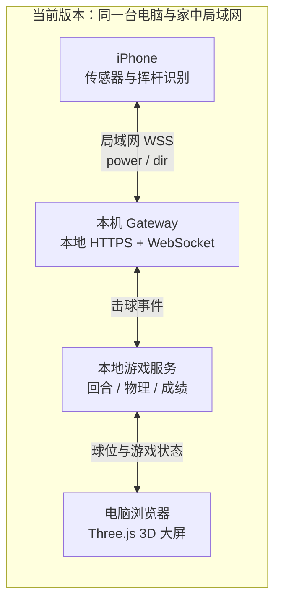
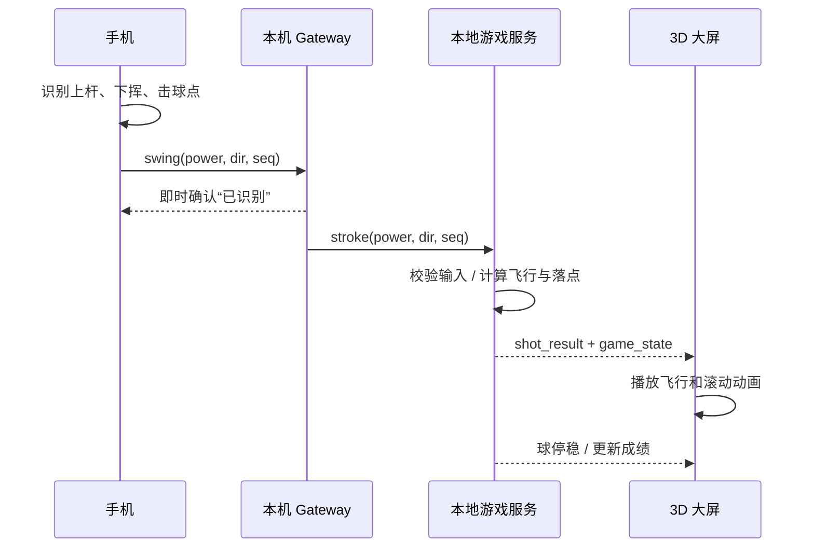
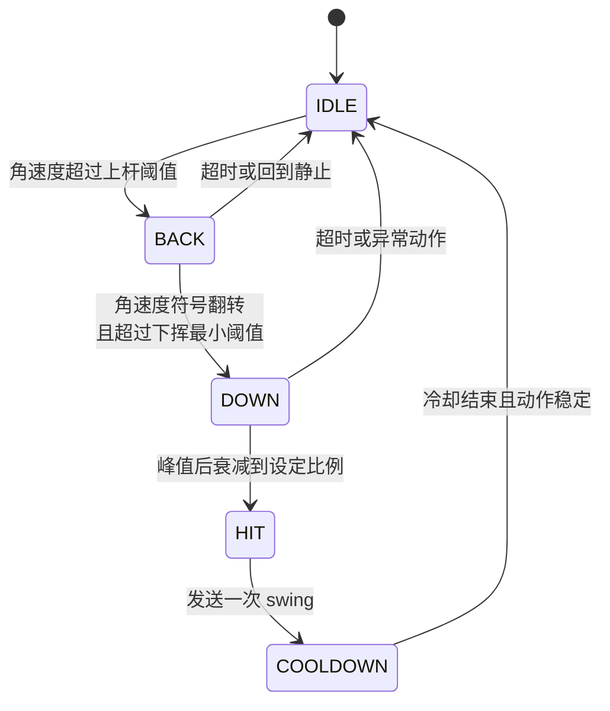

# SwingLink 技术方案

版本：v0.2（讨论稿，加入完整球场、难度与风系统）  
日期：2026-10-26  
配套文档：`PRD.md`

本文只定义结构、协议、算法和参数，不展开具体实现代码。

---

## 1. 总体架构

### 1.1 核心原则

**当前只做单人本地版：原始传感器、球场、物理和成绩全部留在本机/局域网。**

- 手机 → 本机电脑是输入链路，要求低延迟。
- 本地游戏服务是回合、杆数、球位的唯一权威。
- 大屏只渲染本地游戏服务确认的结果；本机可先给“挥杆已识别”的即时反馈。
- 不部署公网服务，不需要房间码或跨洋连接。
- 未来如果增加双人联机，再把同一套本地游戏服务部署为公网房间服务；跨洋只传击球事件与结果，不重写游戏规则。

### 1.2 拓扑图



未来联机只在图外增加一个公网部署位置，不改变手机与本机的输入链路。

### 1.3 一杆的时序



当前版本没有跨洋时序；未来双人联机时，再把本地结果广播给对手大屏。

---

## 2. 进程与职责划分

| 模块            | 运行位置      | 职责                           | 不负责       |
| ------------- | --------- | ---------------------------- | --------- |
| `phone.html`  | 玩家手机浏览器   | 权限、传感器、校准、挥杆状态机、发送 power/dir | 球场规则、最终球位 |
| 本机 Gateway    | 每位玩家自己的电脑 | 托管本地 HTTPS 页面、连接手机、转发击球、日志   | 跨洋房间权威    |
| `screen.html` | 电脑浏览器     | 球场渲染、动画、成绩卡、状态提示             | 自行裁定最终落点  |
| 本地游戏服务        | 本机电脑      | 单人回合、物理、障碍处罚、进洞、成绩与本地状态      | 原始传感器处理   |

本地 Gateway 与大屏可以由同一个本地进程托管，减少安装与配置；但逻辑上仍按“输入链路”和“展示链路”分开。

---

## 3. 技术选型

| 项目   | 选择                                | 理由                              |
| ---- | --------------------------------- | ------------------------------- |
| 手机端  | Safari + DeviceMotion + WebSocket | 无需 App；能取得角速度                   |
| 本地服务 | Node.js，静态页面 + WSS                | 跨 macOS/Windows，依赖少             |
| 本地证书 | mkcert 生成局域网开发证书                  | 满足 iOS 安全上下文要求                  |
| 游戏服务 | 与本地 Gateway 同机运行的 Node.js 服务      | 当前单人无需公网部署；未来可原样迁移              |
| 大屏渲染 | Three.js / WebGL，统一体育卡通 3D        | 3D 与完整球场感是核心体验；PS1 仅作技术参考，不作主风格 |
| 球物理  | 固定时间步长的确定性 2.5D/3D 模型             | 3D 飞行 + 高度场地形；服务器统一积分，不追求写实刚体模拟 |
| 美术资源 | 低模 GLB + 程序地形 + 实例化植被             | 避免手工量产球场模型，统一风格并控制 draw call    |
| 数据存储 | 内存房间状态 + 可选短期持久化                  | 不做账号；重连只需恢复当前局                  |

不建议：

- 用公网临时隧道承担日常“手机 → 本机”输入链路；它会增加延迟和断点。
- 第一版使用 ViGEmBus、键鼠模拟、模拟器或虚拟手柄；游戏由自己实现，无需输入桥接。
- 两端各自跑权威物理；迟早出现球位分叉。
- 把“必须 3D”理解成“必须上完整 3D 刚体物理和写实地形”；视觉空间感与物理复杂度可以分开。
- 为每个球洞手工制作大型 GLB 场景；应共享地形生成器和装饰资源。

---

## 4. iOS 输入链路约束

### 4.1 必须满足

1. 页面必须为 HTTPS/WSS；普通局域网 HTTP 页面不能可靠取得传感器权限与数据。
2. `DeviceMotionEvent.requestPermission()` 必须发生在用户点击事件内。
3. 安装本地根证书后，iPhone 还需在：  
   **设置 → 通用 → 关于本机 → 证书信任设置** 中手动启用完全信任。
4. 页面保持可见并请求 Screen Wake Lock；锁屏/切后台会中断传感器。
5. 正式开局前检查采样是否持续到达，而不是只检查权限弹窗是否通过。

### 4.2 采样率带来的设计边界

- Safari 常见运动数据采样约 60Hz。
- 一次 0.4 秒挥杆只有约 24 个采样点。
- 可用于：识别上杆/下挥、取得峰值、估计准备方向。
- 不应用于：精确重建球杆轨迹、稳定识别杆面角或击球点。
- 因此 v1 只做力量和方向，曲球放到实测后再决定。

---

## 5. 挥杆识别算法

### 5.1 状态机



### 5.2 判定原则

- 使用 `rotationRate`（角速度，deg/s）而非加速度作为主信号。
- 上杆与下挥的符号翻转，用于区分手抖和真正挥杆。
- 下挥阶段记录绝对峰值。
- 峰值过后衰减到约 `0.55 × peak` 时定义为击球点。
- 每次挥杆只发送一次，带递增 `seq` 和冷却窗口。
- 主轴不能仅凭坐标文档假定；M0 必须实测横握时哪一轴最稳定。

### 5.3 初始参数（全部为调参起点）

| 参数               |       初始值 | 用途        |
| ---------------- | --------: | --------- |
| `BACK_START`     | 120 deg/s | 进入上杆      |
| `DOWN_MIN`       |  80 deg/s | 确认反向进入下挥  |
| `HIT_DECAY`      |      0.55 | 峰值衰减击球点   |
| `IDLE_MAX`       |  30 deg/s | 静止判定      |
| `SWING_COOLDOWN` |   1500 ms | 防止重复击球    |
| `POWER_GAMMA`    |       1.6 | 力量非线性曲线   |
| `DIR_FULL_SCALE` |       45° | 手机方向偏移归一化 |
| `MAX_SHOT_ANGLE` |       25° | 最大出球偏角    |

这些不是“正确值”，而是第一版可运行的起点。调参只改配置，不改状态机结构。

---

## 6. 校准与力量映射

### 6.1 每位玩家独立校准

1. 静止约 1 秒：记录方向基准 `dirZero`，并估计噪声水平。
2. 三次正常偏全力试挥：记录三个角速度峰值。
3. 取中位数作为 `peakMax`，避免单次异常挥杆拉偏。
4. 保存于手机 localStorage；提供重新校准。

### 6.2 映射

- 归一化：`x = clamp(peak / peakMax, 0, 1)`
- 力量：`power = x ^ POWER_GAMMA`
- 方向：`dir = clamp((currentDir - dirZero) / DIR_FULL_SCALE, -1, 1)`
- 出球角：`shotAngle = dir × MAX_SHOT_ANGLE`

### 6.3 果岭处理在游戏侧

- 球位在果岭时：`effectivePower = power × 0.15`
- 方向影响：`effectiveDir = dir × 0.30`
- 手机始终发送原始校准后的 power/dir，不根据球场切换逻辑。

---

## 7. 物理与规则模型

### 7.1 服务器唯一权威

服务器收到击球后：

1. 校验房间存在、发送者是当前玩家、球未运动、消息未重复。
2. 根据当前地形和力量上限计算初速度。
3. 计算飞行、落地、滚动、碰撞/处罚、进洞。
4. 写入新球位、杆数、球位地形、下一回合。
5. 广播结果；两端播放表现动画。

### 7.2 简化运动模型

- 飞行段：服务器按固定步长积分三维位置与速度，包含重力、空气阻力、风对相对气流的作用和落地事件；v1 不暴露旋转/曲球控制。
- 风模型：每洞由服务器种子生成 `windVector`，本杆期间恒定；影响飞行段，不影响推杆，不在飞行中随机加入阵风。
- 风信息必须随房间状态提前下发，客户端显示风向、风力及相对瞄准方向的顺/逆/侧风分量。
- 地形段：球场使用规则高度场，球道、果岭、长草、沙坑和水面另用地表类型图或多边形判定。
- 落地与滚动：根据地表类型处理弹跳、速度衰减和滚动；果岭坡度由高度场采样得出。
- 地形只暴露少量可调参数：满力上限、弹跳、滚动衰减、是否可进洞、处罚。
- 所有权威计算采用服务器固定步长，不依赖客户端帧率；Three.js 场景只插值表现结果。

初始待调参数：

| 地形 | 滚动衰减倾向 | 备注        |
| -- | ------ | --------- |
| 果岭 | 最小     | 保证长距离平缓滚动 |
| 球道 | 中低     | 正常滚动      |
| 长草 | 高      | 明显减速      |
| 沙坑 | 很高     | 同时限制下一杆力量 |

### 7.3 进洞判定

必须同时满足：

- 球进入洞杯半径；
- 球速低于 `CAPTURE_SPEED`。

不能只用距离判定，否则快球会直接穿洞。`CAPTURE_SPEED` 以果岭轻推速度为参照，在 M1 实测调整。

### 7.4 一致性策略

- 服务器结果包含 `stateVersion`，单调递增。
- 客户端只接受更新版本，丢弃乱序旧状态。
- 动画仅是表现，不回写权威位置。
- 重连时直接全量下发 `room_state`，不依赖补历史消息。

### 7.5 3D 球场生产管线

每套球场包含 `courseId, theme, difficulty, windProfile, holes[9]`；每个球洞由同一份数据同时驱动物理和渲染：

- `routing`：人工规划的 Par、长度、发球台、球道中心线与宽度、狗腿类型、风险落点和节奏；
- `difficulty`：球道宽度、障碍密度、果岭面积/坡度、旗位集合与风力范围；
- `windProfile`：该球场的风力区间、方向分布和每洞种子规则；
- `heightfield`：规则网格高度，球道适度整平，果岭保留可读坡度；
- `surface`：球道、果岭、长草、沙坑、水面等地表类型；
- `hazards`：水、界外、树木碰撞等规则区域；
- `scenerySeed`：树木、草丛、岩石的位置、旋转、缩放与颜色变体；
- `pin/tee`：旗杆和发球位置。

渲染管线：中心线/地表数据 → 高度场 mesh → 地表着色或贴图 → GLB 装饰实例化 → 跟球镜头。物理只读取高度场和规则区域，不读取 Three.js 场景对象。

### 7.6 可参考实现与素材

以借鉴结构和资源为主，不把整个第三方游戏作为运行依赖。**素材包只提供植被零件，不等于球场美术方案；ThreeWood 只作技术参考，不作视觉目标。**

- **ThreeWood**：Three.js、种子生成 18 洞、手工规划后程序生成、确定性物理和自动公平性测试。重点参考 `course/`、`core/ballSim.js`、渲染与测试边界。仓库：`https://github.com/LeighAtkins/threeWood`。
- **Tiksu Golf**：Bevy/Rust，程序地形和球洞生成。只借生成与可玩性检查思路，不引入其技术栈。仓库：`https://github.com/timoschwarzbach/tiksu-golf`。
- **KayKit Forest Nature Pack**：低模树木、草丛、岩石；免费层包含 100+ 模型，GLTF/OBJ/FBX，CC0。来源：`https://kaylousberg.itch.io/kaykit-forest`。
- **Quaternius Stylized Nature MegaKit**：116 个风格化自然模型，含 glTF，CC0。来源：`https://quaternius.com/packs/stylizednaturemegakit.html`。

素材默认使用 GLB/GLTF，统一缩放、轴向、色板和顶点色。树木/草丛使用 InstancedMesh；限制实时阴影范围和设备像素比。每个资源记录来源、版本、许可证和本地修改，不能直接引用陌生仓库里来源不明的模型。

完整球场风格由渲染层统一负责：地形过渡、地表颜色、天空与雾、水面、主光/环境光、球洞飞越、跟球镜头、旗杆与 HUD 必须使用同一套设计规范。三套球场可更换主题参数，但不能像三个互不相干的素材演示场景。

---

## 8. 消息协议

### 8.1 手机 ↔ 本机 Gateway

| 方向      | 消息             | 关键字段                                |
| ------- | -------------- | ----------------------------------- |
| 手机 → 本机 | `hello`        | `clientId, device, protocolVersion` |
| 手机 → 本机 | `calibrated`   | `peakMax, dirZero, noise`           |
| 手机 → 本机 | `swing`        | `power, dir, peak, seq, clientTime` |
| 手机 → 本机 | `debug_sample` | 仅开发模式，原始统计                          |
| 本机 → 手机 | `ready`        | 连接与协议版本                             |
| 本机 → 手机 | `ack`          | `seq`，本地已收到                         |
| 本机 → 手机 | `input_lock`   | 是否允许下一次挥杆                           |
| 本机 → 手机 | `error`        | 可读原因                                |

注意：本地 `ack` 只代表“动作已收到”，不代表服务器已确认回合结果。

### 8.2 本机 ↔ 公网房间服务

| 方向       | 消息               | 关键字段                                                |
| -------- | ---------------- | --------------------------------------------------- |
| 客户端 → 服务 | `create_room`    | `nickname`                                          |
| 客户端 → 服务 | `join_room`      | `roomCode, nickname, reconnectToken?`               |
| 客户端 → 服务 | `stroke`         | `roomCode, playerId, power, dir, seq, stateVersion` |
| 客户端 → 服务 | `restart_match`  | 房主操作                                                |
| 服务 → 客户端 | `room_state`     | 全量房间快照                                              |
| 服务 → 客户端 | `shot_result`    | `from, to, lie, outcome, stateVersion`              |
| 服务 → 客户端 | `turn_changed`   | `currentPlayer, stateVersion`                       |
| 服务 → 客户端 | `match_finished` | 成绩卡                                                 |
| 服务 → 客户端 | `error`          | 非当前回合、版本冲突等                                         |

### 8.3 房间快照最小字段

- `roomCode, stateVersion, phase`
- `players[]: id, nickname, connected, calibrated`
- `courseId, matchMode, currentHole, currentPlayer`
- `holeSeed, pinPosition, windVector, windSpeed`
- 每人的 `strokes, ballPosition, lie, holed`
- `matchStartedAt, expiresAt`

---

## 9. 延迟与反馈预算

| 链路           |           预期延迟 | 影响          | 设计处理   |
| ------------ | -------------: | ----------- | ------ |
| 手机 → 本机      |        5–15 ms | 直接影响挥杆手感    | 局域网直连  |
| 本机识别 → 本地反馈  |      尽量 <50 ms | 玩家是否觉得“打中了” | 不等公网确认 |
| 本机 → 公网 → 对手 | 120–250 ms 或更高 | 对手看到结果稍晚    | 回合制可接受 |
| 两端动画         |           本地生成 | 视觉流畅        | 不做逐帧同步 |

禁止把“本地即时反馈”也放到服务器往返之后，否则跨洋延迟会被误认为是挥杆识别迟钝。

---

## 10. 部署与网络

### 10.1 本机

- 本地 Gateway 绑定局域网地址，使用手机可访问的局域网主机名/IP。
- mkcert 证书需覆盖该主机名/IP；更换地址后可能需要重新签发。
- 手机与大屏必须在同一局域网，避免访客网络/AP 隔离。
- 防火墙首次弹窗允许本地服务接受连接。

### 10.2 当前无公网部署

- 单人版的页面、WebSocket、球场数据和物理均在本机运行。
- 不购买服务器、不配置域名、不使用第三方托管平台。
- 若未来增加双人联机，再将同一 Node.js 游戏服务部署到普通公网服务器；每个房间串行处理击球，房间状态短期保存。

### 10.3 安全与隐私

- 使用随机、足够长度的房间码；短期有效。
- 不采集姓名、精确位置或传感器历史到公网。
- 公网仅接收 power/dir 及游戏状态。
- 原始传感器日志只留在本机，需用户主动导出。

---

## 11. 可观测性与调参工具

M0 就必须具备，而不是后面补：

- 每次挥杆记录：时间、主轴峰值、状态机路径、power、dir、是否发送。
- 记录误触、漏识别、重复触发，并允许手动标记“这一杆感觉太轻/太重”。
- 最近 50 次挥杆可导出 JSON/CSV。
- 大屏显示当前配置版本，避免双方调的不是同一组参数。
- 公网记录房间状态版本、断线、重连和非法回合事件，不记录原始传感器流。

优先调参顺序：

1. 误触与重复触发；
2. 轻/中/重力量区分；
3. 方向零点与左右一致性；
4. 果岭短推；
5. 最大距离和各地形滚动。

---

## 12. 测试计划

### M0：输入试纸

- 连续 20 次正常挥杆：每次恰好一条 `swing`。
- 10 次拿起/放下/轻抖：不应触发。
- 轻、中、重各 10 次：力量分布应可分。
- 锁屏、切后台、断 WiFi：均有明确状态，不静默失效。
- 换一个人使用：重新校准后也能得到可用力量分布。

### M1/M2：单机球场

- 快球过洞不错误吸入，慢球进洞可靠。
- 球停稳前重复挥杆被锁定。
- 水障碍/界外只罚一次，不错误循环。
- 果岭短推有足够低的力量分辨率。
- 同一输入在服务器重复发送，不产生两杆。
- 3D 跟球镜头不穿地、不突然翻转；低模植被密集时仍保持可玩帧率。
- 相同球场种子在两端生成一致的地形和装饰；物理结果不依赖渲染随机数。
- 相同初速度在顺风、逆风、侧风下产生可重复且方向正确的差异；推杆不受风影响。
- 同一洞同一杆两端的风向量完全一致；球离开发球点后风不会在中途改变。
- 三套球场的难度差异可被实测区分，不只是 UI 标签不同。

### M3：跨洋双人

- 非当前玩家击球被拒绝。
- 两端 `stateVersion` 与球位一致。
- 任意一端刷新后可恢复当前局。
- 弱网/高延迟下，旧消息不会覆盖新状态。
- 球运动中断线，重连后得到最终结果而非卡住。

---

## 13. 建议目录边界

```text
swinglink/
  docs/                 # PRD 与技术方案
  local-gateway/        # 本地 HTTPS、手机连接、转发、日志
  phone-web/            # 授权、校准、挥杆识别、调参页
  screen-web/           # 大屏渲染与动画
  game-service/         # 本地单人回合、权威物理与成绩
  shared/               # 协议类型、常量、纯规则定义
```

`shared` 只放协议和纯定义；权威物理实际只由 `game-service` 调用，避免“共享代码”演变成不同端各自裁定。

---

## 14. 实施顺序与退出条件

1. **M0 输入试纸**：无球场、无联机。
   - 退出条件：力量和方向主观可信；误触/重复触发已解决。
2. **M1 单洞单机**：只做一个低模 3D Par 3，打通地形、跟球镜头和高度场物理。
   - 退出条件：能从发球打到进洞，推杆不令人崩溃，3D 画面和跟球流畅。
3. **M2 首球场三洞**：完成晴空公园前 3 洞、统一美术、风、路线图、处罚和成绩卡。
4. **M3 跨洋联机（后续）**：把同一 Node.js 游戏服务部署到普通公网服务器，再增加 3 洞快速局、重连与版本控制。
5. **M4 完整内容**：先完成首套 9 洞，再扩展海岸林克斯和山谷松林；曲球/下旋留待真实双人反馈后决定。

架构上最容易返工的错误，是在 M0 尚未证明手感前先做大量球场内容。项目应始终把“输入是否成立”放在第一优先级。
